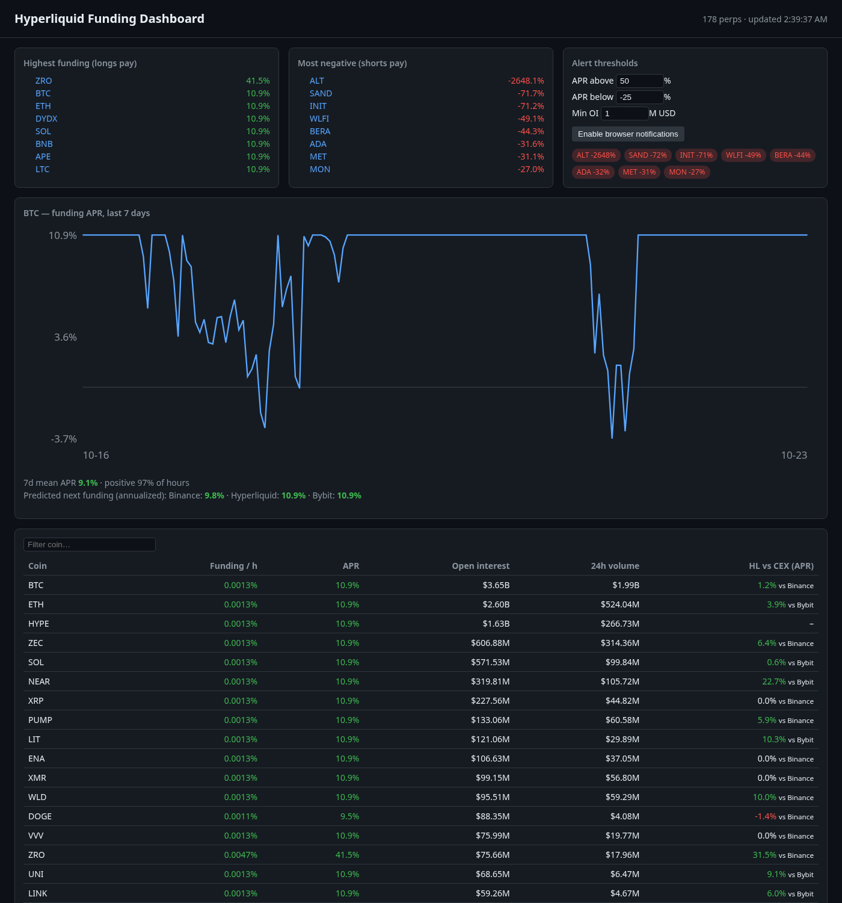
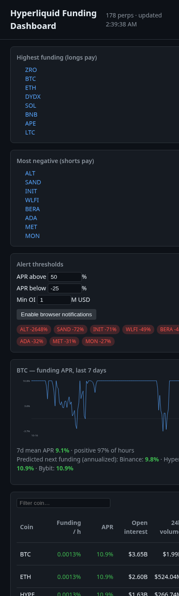

# Hyperliquid Funding Dashboard

A zero-dependency, static dashboard for monitoring perpetual funding rates on
[Hyperliquid](https://hyperliquid.xyz). It runs entirely in the browser against
Hyperliquid's **public, read-only** `info` API. No API keys, no wallet, no trading.



## Features

- **Live table of every perp**: hourly funding, annualized APR, open interest (USD), 24h volume. Sortable and filterable, refreshes every 60s.
- **Top positive / negative funding**: see where longs or shorts are paying the most, filtered by minimum OI to skip illiquid tails.
- **Per-coin history chart**: 7-day funding APR (click any coin), plus mean APR and the share of positive hours.
- **Cross-venue comparison**: predicted next funding on Hyperliquid vs Binance / Bybit (from `predictedFundings`), normalized to APR across different funding intervals, with the largest spread shown per coin.
- **Alert thresholds**: set APR-above / APR-below / min-OI levels. Matches show up as chips, and optional browser notifications fire for newly triggered coins. Settings persist in `localStorage`.

## How it works

| Endpoint (`POST https://api.hyperliquid.xyz/info`) | Used for |
|---|---|
| `{"type":"metaAndAssetCtxs"}` | Universe, funding, mark price, OI, volume |
| `{"type":"predictedFundings"}` | Next funding on HL / Binance / Bybit |
| `{"type":"fundingHistory","coin":"BTC","startTime":…}` | History chart |

The API returns `Access-Control-Allow-Origin: *`, so the page fetches it directly
from the browser and can be hosted for free on GitHub Pages.

APR = `rate / intervalHours × 8760`. Hyperliquid funds hourly; CEX venues usually
use 4h or 8h intervals, so they are normalized before comparing.

```
index.html          layout
src/api.js          tiny fetch client
src/transform.js    pure data logic (unit tested)
src/chart.js        dependency-free SVG chart
src/main.js         UI wiring, alerts, refresh loop
test/               node:test unit tests + optional live API smoke test
```

## Run locally

```bash
npm run serve        # python3 -m http.server 8000 → http://localhost:8000
npm test             # unit tests (Node 18+, no install needed)
npm run test:live    # also hits the real Hyperliquid API
```

## Deploy

`.github/workflows/ci.yml` runs the tests on every push/PR and deploys the site to
GitHub Pages on pushes to `main` (set *Settings → Pages → Source* to **GitHub Actions**).



## Disclaimer

For information only. Not financial advice. Funding rates change every hour, and
predicted rates are estimates.

## License

MIT © 2026 Kent
